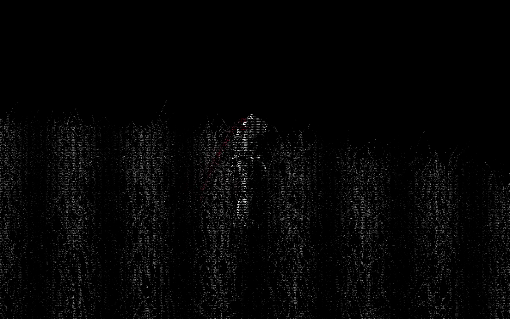

# The Last Bell

_A world waiting to be heard._

An interactive 2.5D ASCII fantasy illustration, built from real geometry, captured human motion and shared wind. Version 0.7 adds a controlled side/three-quarter camera, anatomical weary posture, layered meadow contrast and a recomposed 55-second resting scene.

[Matched A/B review](docs/previews/v07-side-by-side.mp4) · [New presentation](docs/previews/v07-2p5d.mp4) · [Legacy comparison](docs/previews/v07-legacy.mp4) · [Shaded motion](docs/previews/v07-shaded.mp4) · [Validation](docs/VALIDATION.md)



## Run

Node.js 22.13+ or 24+, a current desktop WebGL2 browser, and hardware acceleration are required.

```sh
npm install
npm run dev
```

Choose **Begin Journey** to unlock sound. Press D to travel right toward the waystone about ten metres ahead and press **E** when the rest prompt appears. The knight sits and reclines over ten seconds while the camera continues its 55-second pullback. **Return to the fields** reverses the pose before movement unlocks.

| Control            | Action                             |
| ------------------ | ---------------------------------- |
| A / D              | Travel left / right                |
| W / S              | Shallow depth movement             |
| Shift              | Run                                |
| Mouse / drag       | Small framing adjustments          |
| Wheel              | Zoom                               |
| Double-click world | Recapture mouse                    |
| Space              | Evade                              |
| E                  | Rest near waystone                 |
| Escape             | Pause/resume                       |
| F                  | Fullscreen                         |
| H                  | Controls                           |
| Backquote          | Diagnostics and optional profiling |

Walk/run speeds are 1.35/3.6 m/s, synchronized to calibrated human gait cycles. Reversals brake and turn before recovering speed. Keyboard/mouse gameplay is supported; menus adapt to smaller screens.

## v0.7

- Orthographic side/three-quarter composition, full-body framing, slope-stable tracking, gentle look-ahead and bounded mouse adjustments. A weak-perspective study remains available through `?projection=weak`.
- Distributed pelvis, spine, chest, head and shoulder posture. Native clavicles and neck retain the slouch after retargeting. Captured walk/run, planted contacts, controlled reversals and natural rest/get-up blends remain active.
- Fine foreground grass, clear middle-ground silver/crimson, sparse dark hills and understated real-geometry parallax. Reclining bends nearby grass without clearing or removing it. The distant tower is recomposed for the wider illustration.
- The 55-second sequence widens orthographic coverage and translates gently; both scale and position ease back on return. A virtual audio listener preserves sensible footstep/wind distance and stereo despite the distant rendering eye.
- Projection-aware temporal reprojection, actor-relative half-float depth history, viewport invalidation and frame pacing percentiles/outlier counts in diagnostics.

Independent review controls: `?camera=legacy|2p5d`, `?posture=neutral|weary`, `?render=shaded|ascii`. `?compare` exposes links. Defaults are 2.5D/weary; legacy defaults to neutral when posture is omitted. Legacy mode retains free orbit and camera-relative WASD. The matched recordings use the same knight, world, route and display settings, including the complete pullback, at natural speed with actual game audio.

## v0.6

- The supplied knight is the default after shaded/ASCII comparison and gameplay validation. Its 45-bone skeleton retains original skin weights, fingers and 14 cloth joints. PBR base color, tangent normals, roughness, metallic and AO maps are connected. A small bevel and rigid hinge refine the separate shoulder plate.
- Imported sword, shield, dagger and connected scabbard/hilt components are removed. The existing crimson wrap, torn scarf tails and weighted belt rags share the world wind with the supplied garments. Selected shoulder/belt parts receive restrained rigid secondary motion.
- CMU capture drives anatomical retargeting into the native skeleton. Foot corrections retain release continuity, blend into planting, calibrate stride and respect the supplied boot geometry. Ankle orientation uses the captured ankle-to-ball segment with rest-pose correction. Loop closure includes ankles and pelvis, rather than rotations alone.
- Hero-motion reprojection, half-float history and tighter depth rejection reduce stale glyph trails. Bind-space glyph families remain attached to armor. Shaded rendering is available for diagnosing animation separately from ASCII.
- Fourteen CC0 foley samples layer grass, soft impacts, dry friction and quiet armor response. Actual foot contacts trigger steps; speed controls intensity and brushing. Crossfaded grass tails provide a separate wind-driven vegetation bed. No oscillator or synthesized-noise footstep fallback remains.

Open `/?compare` for model/render links. `/?knight=authored` selects the retained v0.5 model; `/?render=shaded` shows ordinary 3D. The authored comparison retains its sheathed sword. The supplied default carries no weapons.

The owner confirmed their friend created the supplied asset and permitted publication of source files, textures and modified versions. This is project-specific permission, not CC0. See [asset provenance](docs/ASSETS.md).

## v0.5

- Original editable [Blender model](assets/nameless-knight.blend): angular sallet and recessed facial aperture, fitted cuirass/backplate, overlapping shoulder lames, articulated hands/elbows/legs/sabatons and torn, curved lower wool. The bundled GLB is the model used at runtime, with 18 joints and six material groups.
- Replaced KayKit upper-body curves and generated leg swings with retargeted **full-body CMU human capture**. Walk/run cycles, curved walking and separate braking takes drive the pose; contact/terrain IK corrects the captured feet. Starts blend into the full-body performance under controlled acceleration. Motion provenance and product-use terms are in [assets](docs/ASSETS.md).
- Removed tree meshes, lantern meshes/lights/colliders and forearm shield. No exposed stone-path shading remains.
- Continuous stratified grass across a 432 m square, using overlapping near/middle/far representations. Every stratum is populated; the far layer stays present during pullback. Strong traveling bends, delayed recovery and tip flutter share one wind field with cloth and sound.
- Layered neck wrapping, unequal torn tails and contact proxies. Four additional heavy belt/hip rags reuse the scarf solver with restrained wind/inertia and hip/thigh contact.
- Restrained tired-walk lean, support-side shoulder/torso response and step-driven wrist lag supplement the human capture. Wind/rustle are substantially quieter, while coherent grass recovery waves remain clearly visible.
- Measured glyph tone families, bind-space variant selection and staggered baselines reduce regular stripe patterns. Black background and selective silver/crimson reconstruction are preserved.

This remains the hilltop vertical slice. New story chapters, combat, inventory and multiplayer are not implemented.

## Checks and review capture

```sh
npm run typecheck
npm run lint
npm run format:check
npm test
npm run build
npm run preview
npm run test:browser
```

Browser validation uses installed Google Chrome and Playwright FFmpeg (`npx playwright install ffmpeg`). It drives real controls and checks errors, wind CPU/GPU parity, actual sound controls, menus, movement, rest, pause, return, resizing and fullscreen. Detailed output stays in ignored `test-results/`.

The separate review recorder captures the game canvas at requested 60 Hz together with the actual Web Audio master bus:

```sh
npm run record:v07
CAPTURE_MODE=2p5d RENDER=shaded npm run record:v07
node scripts/compress-v07.mjs
node tests/presentation-studies.mjs
node tests/frame-pacing.mjs
# Numerical native-skeleton checks use the Vite development server on port 5173.
node tests/animation-stability.mjs
```

It retains uninterrupted walking/running sequences. Both ASCII recordings retain the full route and 55-second pullback. The shaded edit retains consecutive walk/run cycles and key rest/return segments. The side-by-side file shows A on the left, B on the right, with B audio. No source reference media or raw captures are committed. Diagnostic capture streams require `?diagnostics`; they do not control the simulation.

## Authoring

```sh
# Requires Blender; set BLENDER to its executable on other systems.
npm run export:knight
# Requires the specific original CMU subject-16 ASF/AMC files listed in ASSETS.md.
npx tsx scripts/retarget-locomotion.ts /path/to/cmu-subject-16
npm run format
```

Convert the supplied source with Blender:

```sh
blender -b --python scripts/import-knight.py -- knight public/models/imported-knight
```

The converted GLB and editable scene are committed alongside the supplied FBX and textures. `author-knight.py` regenerates the editable Blender scene and neutral-axis rigged GLB. The GLB is about 3.3 MiB. Runtime loads that local asset; no character CDN or external service is needed.

[Architecture](docs/ARCHITECTURE.md) · [Reference study](docs/VISUAL_REFERENCES.md) · [Validation](docs/VALIDATION.md) · [Provenance](docs/ASSETS.md) · [Roadmap](docs/ROADMAP.md)
