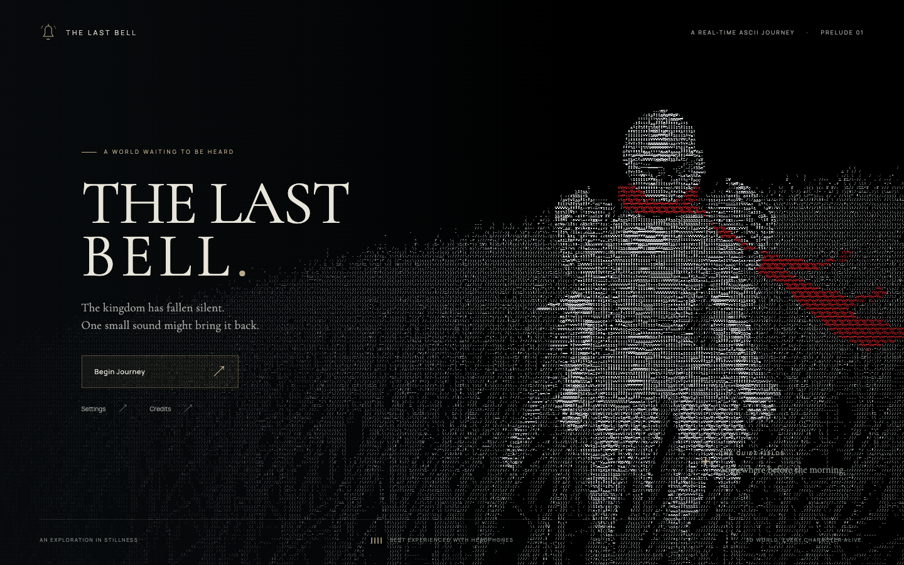

# The Last Bell

_A world waiting to be heard._

A playable third-person fantasy scene reconstructed entirely from ASCII glyphs on the GPU. Version 0.4 adds hybrid authored locomotion, a sheathed sword, a torn crimson scarf, tall wind-swept grass and sparse amber lantern posts. The existing controls, sound, UI and 55-second hilltop interaction remain intact. This is a vertical slice of the planned RPG.

[Watch the v0.4 gameplay preview](docs/previews/v04-gameplay.mp4) · [Validation and eleven captures](docs/VALIDATION.md)



## Play locally

Requires Node.js 22.13+ (22 LTS), or 24+ and a current desktop WebGL2 browser with hardware acceleration.

```sh
npm install
npm run dev
```

Open the URL printed by Vite (usually **http://localhost:5173**) and choose **Begin Journey** to unlock audio. Walk forward toward the waystone, about 10 metres from the spawn. Press **E** when **Press E to Rest** appears. The knight prepares, sits and reclines over ten seconds; the camera continues its real-time pullback to 55 seconds. **Return to the fields** reverses the rest pose before movement unlocks. Escape pauses either mode.

Keyboard/mouse gameplay is supported; menus adapt to smaller viewports.

| Control                  | Action                                   |
| ------------------------ | ---------------------------------------- |
| WASD                     | Camera-relative movement                 |
| Mouse                    | Look while captured                      |
| Drag either mouse button | Orbit without capture                    |
| Wheel                    | Zoom for detail inspection               |
| Double-click world       | Capture mouse again                      |
| Shift                    | Run                                      |
| Space                    | Evade                                    |
| E                        | Rest near waystone                       |
| Escape                   | Pause/resume and release mouse           |
| F                        | Fullscreen                               |
| H                        | Control help                             |
| Backquote                | Diagnostics and opt-in CPU/GPU profiling |

Walking is 1.65 m/s and running is 4.4 m/s, matched to the new leg stride. Left mouse combat is reserved for a future milestone.

## What changed in 0.4

- Adapted KayKit CC0 authored idle/walk/run upper-body motion to the original 18-joint rig; layered in acceleration, forward lean, hip weight transfer, torso counter-motion, turning and stabilized head movement. Contact-controlled legs retain planted feet and terrain IK.
- Freed both hands. A detailed sword sits inside a separately mounted left-hip scabbard, with a future drawing attachment.
- Replaced the cape/tabard with a neck wrap and three narrow, asymmetric torn scarf ribbons. Fixed-step constrained simulation adds movement inertia, flutter and shared-wind response, plus terrain/body exclusion.
- Taller curved grass bends strongly in traveling gusts. The same field drives scarf forces and more pronounced wind/rustle audio modulation.
- Added fifteen medieval iron lantern posts, restrained amber flames and four local lights. No global scene brightening.
- Refined silver tonal range, glyph variation, semantic color reconstruction and moving-character framing while keeping black sky and the existing rest/pullback.

The suit/world art remain original. Authored motion provenance and honest limits are recorded in [assets](docs/ASSETS.md) and [validation](docs/VALIDATION.md).

## Verify and build

```sh
npm run typecheck
npm run lint
npm run format:check
npm test
npm run build
npm run preview
```

ESLint performs real code linting; Prettier checks formatting separately. GitHub Actions runs type checking, lint, format, unit tests and build on pushes/PRs. The 28 system tests include rock matrices versus colliders, GLB skin data, grass templates, temporal behavior, foot planting/clearance, rest/reverse at 30/60/144 Hz, camera continuity existing movement/interaction systems, shared wind identity/propagation and gust/audio correlation.

With dev or preview running in another terminal:

```sh
npx playwright install ffmpeg
npm run test:browser
# Test built production output instead:
TEST_URL='http://localhost:4173/?diagnostics' npm run test:browser
```

The test uses installed Google Chrome. To use downloaded Chromium, run `npx playwright install chromium ffmpeg`, then `BROWSER_CHANNEL=chromium npm run test:browser`. It drives actual inputs, captures all eleven requested views, records `test-results/overhaul-motion.webm`, checks silver/red readability, predominantly black output, shared GPU/CPU wind, live audio correlation, pause/rest/return, settings/fullscreen and errors. Full PNGs, video and detailed metrics remain in ignored `test-results/`. Diagnostic snapshots are read-only and available in development or with `?diagnostics`.

`npm run build` creates `dist/` for static hosting, with relative URLs for subpaths. No backend, account, CDN, reference video or character download is required at runtime.

## Model and documentation

```sh
npm run export:knight
```

Regenerates [nameless-knight.glb](public/models/nameless-knight.glb), a Blender-compatible original bind-pose model with its 18-joint skin. The game uses the same source builder directly. Append `?knight=prototype` to view the preserved original fallback. Runtime animation and cloth simulation are not baked into the export.

[Architecture](docs/ARCHITECTURE.md) · [Reference comparison](docs/VISUAL_REFERENCES.md) · [Validation/captures](docs/VALIDATION.md) · [Assets/provenance](docs/ASSETS.md) · [Roadmap](docs/ROADMAP.md)

No village, combat, inventory, climbable tower, restoration sequence, helmet removal, full story or multiplayer was added. Further animation/contact polish can continue within the same hilltop scene.
